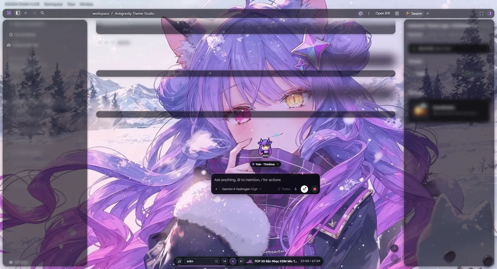

# Antigravity Custom Theme Skill

Turn any wallpaper, aesthetic mood, or color palette into a live, 60fps custom theme inside **Antigravity** — featuring a **Topbar ✨ One-Click AI Theme Generator** (powered by `agy` CLI using your own Antigravity login, zero API key required), a **Custom Theme Studio**, a standalone cross-platform CDP daemon, and a drop-in **AI Agent Skill** (`SKILL.md`).

> Click the **✨** button in Antigravity's topbar (or drag & drop an image onto it) to open **Custom Theme Studio**, drop/paste (`Ctrl+V`)/pick any image, and let `agy` CLI design a balanced Light/Dark glass palette plus two bespoke SVG ornaments matching the artwork's motifs.

---

## 🤖 For AI Agents — Automated 1-Shot Install Protocol

If a user gives you this repository URL or clones it into their Antigravity workspace and asks you to install it, follow **every step below in order** — do not skip verification:

1. **Install into the canonical global skill path** (so there is only **one** copy and no conflicting old daemon):
   - **Windows (PowerShell):**
     ```powershell
     $Dest = "$HOME\.gemini\config\skills\antigravity-custom-theme"
     if (Test-Path "$Dest\.git") { git -C $Dest pull --ff-only } else { git clone https://github.com/Neito112/antigravity-theme-studio.git $Dest }
     cd $Dest
     ```
   - **macOS / Linux (Bash):**
     ```bash
     DEST="$HOME/.gemini/config/skills/antigravity-custom-theme"
     if [ -d "$DEST/.git" ]; then git -C "$DEST" pull --ff-only; else git clone https://github.com/Neito112/antigravity-theme-studio.git "$DEST"; fi
     cd "$DEST"
     ```
2. **Compile the payload with Node.js >= 22 (zero Python required):**
   ```bash
   node scripts/build_payload.js
   node --check dist/theme_payload.js
   ```
3. **Install & launch the CDP daemon (automatically stops conflicting old daemons across folders):**
   - **Windows (PowerShell):**
     ```powershell
     powershell -ExecutionPolicy Bypass -File scripts/install-win.ps1
     ```
   - **macOS / Linux (Bash):**
     ```bash
     bash scripts/install-unix.sh
     ```
4. **CRITICAL — Windows AI Agent Sandbox Survival Check:**
   On Windows, many AI agent shell runners wrap normal commands in a **Windows Job Object** that kills spawned background processes (`wscript.exe` / `node.exe`) as soon as the shell tool call returns. **Always check in a separate command** whether the PID in `daemon.pid` is still alive:
   ```powershell
   $p = Get-Content daemon.pid -ErrorAction SilentlyContinue; Get-Process -Id $p -ErrorAction SilentlyContinue
   ```
   - If the daemon died when the previous shell call exited, launch it using your runner's long-running daemon mode (`IsDaemon: true` / persistent background task) with:
     ```powershell
     node daemon/theme_daemon.js
     ```
     (or `powershell -ExecutionPolicy Bypass -File scripts/install-win.ps1 -Foreground`).
   - Also inform the user to run `powershell -ExecutionPolicy Bypass -File "$env:USERPROFILE\.gemini\config\skills\antigravity-custom-theme\scripts\install-win.ps1"` once from their own PowerShell terminal if they want Windows Startup auto-launch outside the agent sandbox.
5. **Verify live UI + Topbar ✨ button via CDP (mandatory pass criteria):**
   ```bash
   node scripts/verify_cdp.js
   ```
   Report installation as **successful only when ALL four checks pass**:
   - `themeActive: true`
   - `topbarButtonPresent: true`
   - `topbarButtonVisible: true`
   - `hasLiveBlurRule: false`

---

## Screenshots

### Live Antigravity UI (`Luminous Grotto` AI Preset)


### Topbar ✨ Quick Theme & AI Generator Popup


## Features

- **Topbar ✨ One-Click AI Theme Generator (`agy` CLI):**
  - Injects a sparkle (`✨`) button into Antigravity's topbar (`[data-testid="pane-titlebar-toolbar"]` or IDE `.part.titlebar .titlebar-right`) with a 3-layer self-healing watchdog (multi-fallback DOM mount + floating fallback + 2s DOM watchdog + 10s CDP daemon health check) so it survives Antigravity UI re-renders and updates.
  - Clicking ✨ opens **Custom Theme Studio** directly; drag & drop an image onto the ✨ button or into the Studio dropzone, paste (`Ctrl+V`), or browse from disk.
  - `daemon/theme_designer.js` invokes `agy -p --disable-slash-commands --json-schema ...` using your own Antigravity quota (no external API key needed) to design a cohesive glass palette (`primary`, `secondary`, `overlayRgb`, adaptive Light/Dark mode) plus two custom SVG flourishes (`cornerSvg` & `sticker`). Falls back gracefully to client-side palette extraction if `agy` is unavailable.
- **Manual Preset Deletion & 1-Click Cleanup (`🗑️`):**
  - Delete individual custom presets or hide built-in presets cleanly from **Theme Presets** in **Custom Theme Studio** (while always keeping at least one active preset).
  - Use **🗑️ Xóa tất cả tự tạo** to clear all generated presets in one click, or **↺ Khôi phục preset gốc** to restore hidden built-in presets.
  - Syncs across `localStorage`, `window.__AGY_INITIAL_CONFIG__`, and `theme_config.json` so deleted presets never reappear on reload.
- **Zero Live Blur Architecture (60fps Scroll):** Uses pre-baked offscreen canvas glass (`syncPrebakedGlass`) and gradient scrims instead of CSS `backdrop-filter: blur()`, preventing Electron/GPU scroll lag.
- **Unified L-Glass + Split-Browser Safe:** Automatically detects Antigravity's split embedded Chromium view (`data-has-browser-hole`) and cuts an `evenodd` `clip-path` window so embedded pages stay untouched and sharp.
- **Custom Theme Studio:** Switch presets, mix and match user chat bubbles & composer frame styles, upload custom wallpapers or **User / AI Agent circular avatars** (auto-compressed WebP), tune scrim dimming & pre-baked blur, and export/import JSON configs.
- **Cross-Platform Daemon (`daemon/theme_daemon.js`):** Windows, macOS, and Linux support using Node >= 22 built-in `WebSocket` (zero `npm install` needed).

## Included Presets

| Preset | Concept & Mood | Wallpaper | Chat Ornament |
| :--- | :--- | :---: | :---: |
| **Luminous Grotto** | Bioluminescent Grotto & Sunlit Automaton • Abyssal Flora Glass |  |  |
| **Celestial Eclipse** | Black Sun & Orbital Rings • Obsidian Starlight Glass |  |  |
| **WLOP Cosmic** | Cosmic Violin & Starlight • High-Contrast Glass |  |  |
| **Midnight Obsidian** | Pure CSS Gradient • Zero-Image Ultra-Light | *Pure CSS radial/linear gradient* | *Minimal clean* |

## Prerequisites

- **Antigravity** running with CDP debugging port active (`DevToolsActivePort` or `--remote-debugging-port=9222`)
- **Node.js >= 22** (required — uses native `globalThis.WebSocket`, zero `npm install` needed)
- **Antigravity CLI (`agy`)** authenticated locally (optional; enables full AI preset & SVG ornament generation from Custom Theme Studio)
- **Python 3.9+ with `Pillow`** (optional — only needed when using `scripts/build_payload.py` to auto-compress large >2K custom wallpapers into WebP)

## Quick Start (Manual)

### 1. Build the Runtime Payload

```bash
node scripts/build_payload.js
```

*(Optional: run `python scripts/build_payload.py` instead if you have Pillow installed and added large >2K raster wallpapers to `themes/assets/`.)*

This resolves `themes/themes.json` + `themes/assets/*` and compiles them with `engine/core.js` into gitignored `dist/theme_payload.js`.

### 2. Install & Run the Daemon

**Windows (PowerShell):**

```powershell
powershell -ExecutionPolicy Bypass -File scripts/install-win.ps1
```

Creates a hidden launcher in your Windows Startup folder (`AntigravityCustomTheme.lnk`) without hardcoding paths, stops any old conflicting daemon instances, rebuilds `dist/theme_payload.js`, and attaches silently. Pass `-NoStartup` to skip Startup registration, or `-Foreground` to run in the active terminal.

**macOS / Linux (Bash):**

```bash
bash scripts/install-unix.sh
```

- On **macOS**, installs a `~/Library/LaunchAgents/io.antigravity.custom-theme.plist` LaunchAgent.
- On **Linux**, installs a `systemd --user` service (or falls back to `nohup`).
- Use `bash scripts/install-unix.sh --foreground` to run interactively in your terminal, or `stop` / `status`.

> **Platform Testing Note:** Windows (`install-win.ps1`, CDP hot-reload, topbar AI generator, uninstall) has been verified live against Antigravity on Windows 11. macOS (`launchd`) and Linux (`systemd --user`) scripts are implemented and shell-syntax verified, and welcome community runtime feedback across macOS/Linux setups (you can override `DevToolsActivePort` location anytime via `AGY_PORT_FILE=/path/to/DevToolsActivePort` or set `AGY_CDP_PORT=9222`).

### 3. Verify Live via CDP

```bash
node scripts/verify_cdp.js
```

### 4. Uninstall Cleanly

```bash
node scripts/uninstall.js
```

Removes auto-start shortcuts/services, stops the background daemon, and immediately restores Antigravity's default styling on open windows.

## Troubleshooting

| Symptom | Cause | Fix |
| :--- | :--- | :--- |
| `verify_cdp.js` says `Cannot connect to Antigravity CDP` or missing `DevToolsActivePort` | Antigravity hasn't exposed CDP yet or uses a custom user-data dir | Restart Antigravity normally, or launch with `--remote-debugging-port=9222`, or set `AGY_PORT_FILE` / `AGY_CDP_PORT` |
| `Node.js >= 22 is required` | System Node is older than v22 (missing built-in `WebSocket`) | Upgrade Node.js to LTS >= 22 (`node -v`) |
| `install-win.ps1` succeeded inside an AI agent, then button disappears or `verify_cdp.js` fails | Agent runner's Windows Job Object killed `wscript.exe`/`node.exe` when the command exited, or an older clone's daemon overwrote it | Run `node daemon/theme_daemon.js` via long-running daemon mode (`IsDaemon: true`) and re-run `install-win.ps1` in a user PowerShell window |
| Theme loads (`themeActive: true`) but ✨ topbar button is missing | Older daemon running from another clone, or Antigravity changed topbar selectors | Run `install-win.ps1` / `install-unix.sh` from the updated clone (kills old daemons + rebuilds); floating fallback mounts automatically if selectors change |

## Use as an Antigravity Skill (`SKILL.md`)

Clone this repository into your global skill directory:

```text
~/.gemini/config/skills/antigravity-custom-theme/
```

Once installed, prompt your Antigravity agent with an image and aesthetic preference (e.g., *"Use `antigravity-custom-theme` to build me a dark emerald studio Ghibli theme from this image"*), or click the topbar ✨ button directly.

## Repository Structure

```text
antigravity-custom-theme-skill/
├── SKILL.md                             # Agent skill definition & workflow
├── README.md
├── LICENSE                              # MIT
├── docs/
│   ├── preview_luminous_grotto.webp     # Live Antigravity UI screenshot
│   └── preview_topbar_popup.webp        # Topbar ✨ AI generator & manager screenshot
├── references/
│   └── theme-schema.md                  # themes.json schema & DOM notes
├── themes/
│   ├── themes.json                      # Built-in theme presets
│   └── assets/                          # Wallpapers & SVG stickers/corners
├── engine/
│   └── core.js                          # Core injection engine (Zero Live Blur, topbar button, Studio UI)
├── daemon/
│   ├── theme_daemon.js                  # Cross-platform CDP injector & config persistence
│   └── theme_designer.js                # Headless agy CLI wrapper for AI preset & SVG generation
├── scripts/
│   ├── build_payload.js                 # Zero-dependency Node >= 22 compiler (default)
│   ├── build_payload.py                 # Optional Python + Pillow compiler (>2K WebP compression)
│   ├── install-win.ps1                  # Windows Startup launcher setup & daemon dedup
│   ├── install-unix.sh                  # macOS LaunchAgent / Linux systemd user setup
│   ├── uninstall.js                     # Clean cross-platform removal
│   └── verify_cdp.js                    # Live CDP diagnostic & topbar/blur assertions
└── dist/                                # Gitignored compiled runtime output
```

## License

MIT
