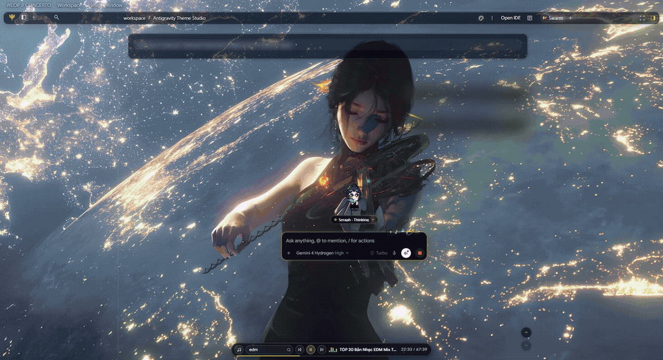
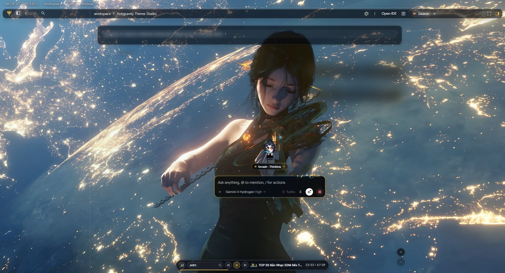
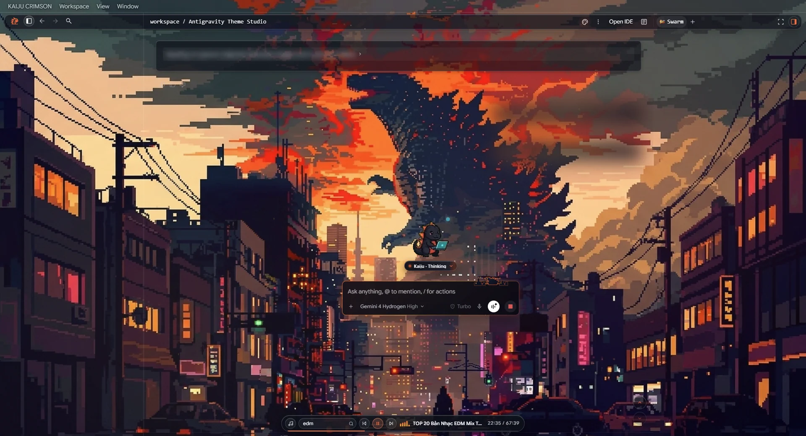
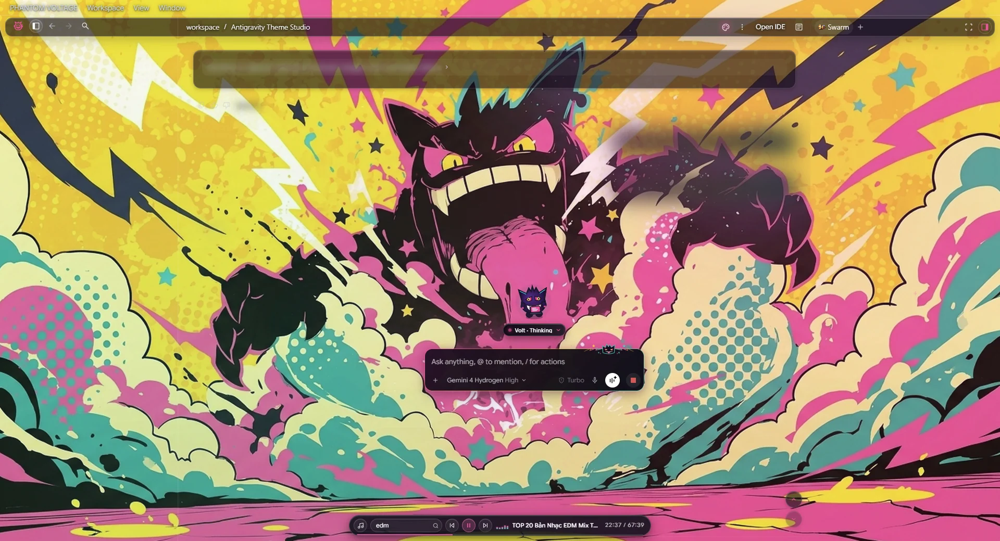
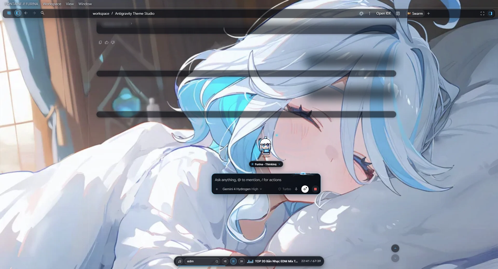
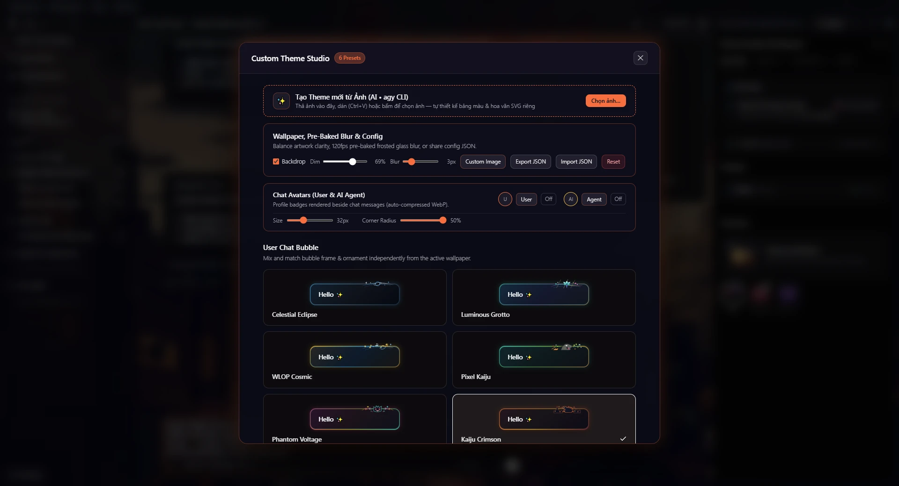
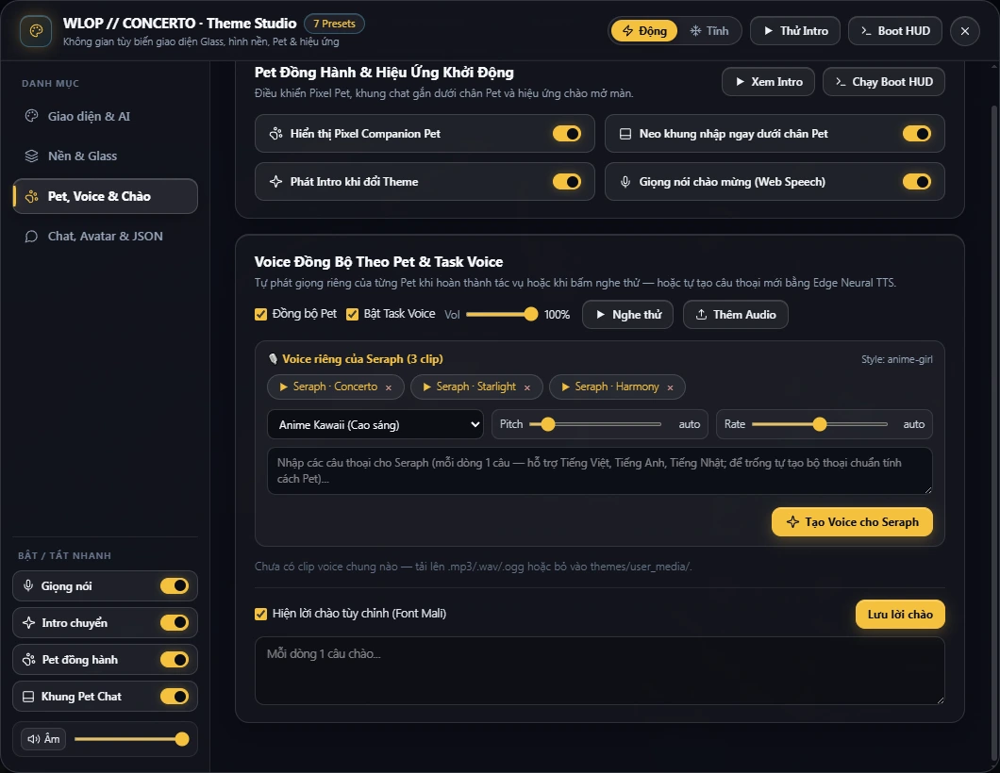

# Antigravity Custom Theme Studio (`fusion-edition`)

Bộ công cụ tùy biến toàn diện giao diện **Antigravity Desktop** với cơ chế **Unified Smoked Glass (Zero Live Blur)**, **Custom Theme Studio V2**, **AI Theme Designer (tự mở rộng ảnh 16:9 4K + trích bảng màu + vẽ ornament SVG)**, **Inline YouTube Music Player**, **Tự động đổi Icon & Favicon Antigravity theo Theme**, **Pet Neural Voice (`edge-tts`) đồng bộ từng nhân vật**, và **Companion Pet `8×11` bám sát từng ảnh gốc**.

<p align="center">
  
</p>

> **Video chất lượng cao (1280×694 H.264 MP4):** [`docs/preview_showcase.mp4`](docs/preview_showcase.mp4)

---

## Tính năng cốt lõi & Điểm mới (Studio V2)

### 1. Inline YouTube Music Player (`#agy-yt-bar`)
Nghe nhạc YouTube trực tiếp ngay bên trong Antigravity không cần mở tab trình duyệt ngoài:
- **Tìm kiếm & phát nhạc tại chỗ:** Gõ tên bài hát / thể loại (`edm`, `nhạc không lời`, `lofi`, tên bài cụ thể...) ngay trên thanh mini player dưới đáy workspace -> daemon tìm kiếm (`agyYtSearch`) và giải mã audio stream tốc độ cao (`agyYtResolve`) qua YouTube bridge cục bộ.
- **Điều khiển đầy đủ:** Phát / Tạm dừng, Chuyển bài trước/sau trong danh sách kết quả tìm kiếm, hiển thị tên bài + thời lượng (`mm:ss / mm:ss`), và cột sóng **Equalizer động** đổi màu theo `--primary` / `--secondary` của theme đang bật.

### 2. Tự Động Đồng Bộ Icon Mặc Định Antigravity Theo Theme
Mỗi khi đổi theme, toàn bộ nhận diện gốc của Antigravity tự động chuyển sang biểu tượng và bảng màu của theme đó (`syncDynamicAppIcon` + `agyUpdateAppIcon`):
- **Favicon & Tab Icon (`<link rel="icon">`):** Sinh icon SVG/PNG `128×128` bo góc viền gradient đồng bộ tức thì ngay khi đổi preset.
- **Logo góc trên bên trái & Watermark nền:** Thay biểu tượng Antigravity mặc định bằng logo/huy hiệu vector (`brandLogoUrl` / `sigilSvgInner`) tương ứng từng bộ theme.
- **Icon Cửa sổ & Taskbar Windows (`WM_SETICON`):** Daemon tự tạo `themes/user_media/active_app_icon.ico` (PNG-in-ICO `128×128`) và gửi `SendMessageTimeoutW` (`WM_SETICON` nhỏ & lớn) vào cửa sổ Antigravity đang mở.
- **Shortcut `.lnk` Desktop / Start Menu / Taskbar:** Tự động cập nhật `IconLocation` sang `active_app_icon.ico,0` và tự động khôi phục về `Antigravity.exe,0` khi chạy `scripts/uninstall.js`.

### 3. Unified Smoked Glass UI & Swarm Sidecar Glass
- **Zero Live Blur:** Toàn bộ sidebar, header, chat card, khung nhập nổi và Swarm Board sidecar dùng kính tối bán trong suốt có tương phản cao (`clearBackdrop`, `sidebarEnhanceText`), tuyệt đối không dùng `backdrop-filter: blur()` runtime nên cuộn mượt ở 4K.
- **Swarm Board Sidecar (`plugin://swarm--swarm_board`):** Tự động áp dụng lớp kính trong suốt đồng bộ màu theme và ghim cố định header + thanh search bằng flex column, không bị trôi hay đè chữ.

### 4. Custom Theme Studio V2 & Tạo / Chau chuốt Theme từ Ảnh Bất Kỳ
- **Tạo mới từ mọi loại ảnh:** Hỗ trợ ảnh dọc, ảnh vuông, ảnh độ phân giải rất nhỏ, ảnh PNG nền trong suốt hoặc ảnh sáng ban ngày (`normalizeTo4k16x9Webp` + `finalize4k16x9Wallpaper`).
- **Tạo lại & Yêu cầu AGY chau chuốt bằng Text:** Nhập trực tiếp mô tả mong muốn (màu chủ đạo, style Pet, độ tối kính...) vào ô text ngay trên đầu Studio và bấm **Tạo lại / Chau chuốt** (hoặc nút `↻` trên từng preset card).

### 5. Companion Pet `8×11` Bám Sát Ảnh Gốc & Floating Pet Composer
- Khung nhập liệu tự co kéo chiều cao theo văn bản (không có thanh cuộn thừa), neo mượt dưới chân Pet hoặc đặt cuối màn hình.
- Từng theme đi kèm bộ sprite sheet `8×11` (`1536×2288`) riêng phản ứng theo trạng thái `Idle / Run / Wave / Jump / Dizzy / Thinking / Ready` và dõi theo con trỏ chuột theo 16 hướng:
  - **9 bộ Pet tích hợp sẵn:** *WLOP Cosmic (`Seraph`)*, *Furina Live (`Furina`)*, *Gemini-chan Live (`Yuki`)*, *Celestial Eclipse (`Solara`)*, *Luminous Grotto (`Lumia`)*, *Miku Cyber (`Miku`)*, *Midnight Obsidian (`Onyx`)*, *Codex Dark Pro (`Byte`)*, *Claude Warm Charcoal (`Solis`)*.
  - **Hỗ trợ sinh Pet đồng bộ cho Custom Theme:** Tự động tạo sprite sheet `8×11` bám sát nhân vật/vật thể trong ảnh upload (ví dụ *Kaiju Crimson (`Kaiju`)*, *Pixel Kaiju (`Rexy`)*, *Phantom Voltage (`Volt` Gigantamax Gengar)*).

### 6. Pet Neural Voice (`edge-tts`) & Trình Tạo Voice Trực Tiếp Trong Studio
Mỗi nhân vật Pet sở hữu bộ thoại neural riêng (`petVoices`), tự phát khi hoàn thành tác vụ, khi đổi theme hoặc khi bấm chuột phải vào Pet → **Nghe `<Pet>` nói**:
- **9 Bộ Voice Tích Hợp Sẵn (`themes/assets/voice/pets/`):** Được tổng hợp sẵn (3 clip mỗi preset) theo tính cách từng nhân vật — quý tộc dịu dàng (*Furina*), kawaii anime (*Yuki*, *Miku*), thanh tao sâu lắng (*Seraph*, *Solara*), hộ vệ trầm ấm (*Lumia*), stealth/telemetry bot (*Onyx*, *Byte*) và học giả ấm áp (*Solis*); kèm profile mặc định trong `daemon/voice_generator.js` cho các nhân vật phổ biến như *Kaiju*, *Rexy*, *Volt*.
- **Trình tạo Voice trực tiếp trong tab `Pet, Voice & Chào`:** Cho phép chọn 12 kiểu giọng (`Tự động theo Pet`, *Anime Kawaii (Cao sáng)*, *Quý tộc / Dịu dàng*, *Thanh tao sâu lắng*, *Tinh quái / Ranh mãnh*, *Trầm hùng / Kaiju*, *Hộ vệ trầm ấm*, *Cyber Telemetry Bot*, *Học giả ấm áp*, *Tiếng Việt (Nữ - Hoài My)*, *Tiếng Việt (Nam - Nam Minh)*, *Tiếng Nhật Kawaii (Nanami)*), tinh chỉnh **Pitch (`-35..+35Hz`)** & **Rate (`-25..+35%`)**, nhập nhiều câu thoại và bấm **Tạo Voice cho `<Pet>`** (bridge `agyGeneratePetVoice` → `daemon/voice_generator.js` → `edge-tts`).
- **Tự động nhận diện ngôn ngữ (`vi` / `ja` / `en`):** Tự chuyển sang neural voice Tiếng Việt, Tiếng Nhật hoặc Tiếng Anh khớp từng dòng thoại bạn nhập; hỗ trợ bật/tắt **Đồng bộ Pet**, nghe thử hoặc xóa từng clip riêng lẻ.
- **Tự động sinh Voice khi tạo Theme mới từ ảnh:** Cả luồng AI lẫn fallback cục bộ đều tự động tạo kèm 3 clip `.mp3` tại `themes/user_media/voices/` cho nhân vật Pet vừa sinh ra.

---

## Bộ Preset Tích Hợp Sẵn (`themes/themes.json`)

| Theme | Nhân vật / Concept | Companion Pet (`8×11`) | SVG Ornament & Corner |
| --- | --- | --- | --- |
| **WLOP Cosmic** | *WLOP // Concerto* — Cosmic Violin & Starlight | `Seraph` (Váy đen, búi tóc trâm vàng, vĩ cầm cyan) | `wlop_corner.svg` / `wlop_ornament.svg` |
| **Furina Live** | *Fontaine // Furina* — Áo ngủ bạch lam & ahoge | `Furina` (Áo trắng cổ xanh, tóc bạch-lam xoắn ahoge) | `furina_corner.svg` / `furina_ornament.svg` |
| **Gemini-chan Live** | *Gemini-chan // Live* — Snowy Violet MP4 | `Yuki` (Tóc tím-hồng, tai mèo, kẹp 4 sao, khăn caro) | `gemini_chan_corner.svg` / `gemini_chan_ornament.svg` |
| **Celestial Eclipse** | *Celestial // Eclipse* — Hắc tinh cầu & quỹ đạo sao | `Solara` (Tinh cầu nhật thực & vành đai quỹ đạo sao) | `celestial_corner.svg` / `celestial_ornament.svg` |
| **Luminous Grotto** | *Luminous // Grotto* — Hang động phát sáng & Automaton | `Lumia` (Chibi Golem đá xám đội 3 mầm phát sáng ngọc lam) | `luminous_grotto_corner.svg` / `luminous_grotto_ornament.svg` |
| **Miku Cyber** | *Miku // Stage* — Cyber Acrylic & Video 1080p | `Miku` (Váy trắng đi biển, mũ rộng vành & twin-tail xanh ngọc) | `miku_corner.svg` / `miku_ornament.svg` |
| **Midnight Obsidian** | *Midnight // Obsidian* — Hắc thạch & Pure CSS siêu nhẹ | `Onyx` (Cáo Obsidian đen tai xanh ánh bạc) | `midnight_obsidian_corner.svg` / `midnight_obsidian_ornament.svg` |
| **Codex Dark Pro** | *Codex // Dark* — Concentric Telemetry & Deep Carbon | `Byte` (Bot tròn 2 râu ăng-ten ngọc & kính visor cyan) | `codex_corner.svg` / `codex_ornament.svg` |
| **Claude Warm Charcoal** | *Claude // Charcoal* — Editorial Typography & Warm Carbon | `Solis` (Chú cáo/gấu trúc nhỏ màu cam ấm hổ phách) | `claude_corner.svg` / `claude_ornament.svg` |

---

## Ảnh Chụp Thực Tế

| **WLOP Cosmic + Music Bar & Swarm Glass** | **Kaiju Crimson (Custom Theme + `Kaiju` Pet)** |
| :---: | :---: |
|  |  |
| **Phantom Voltage (Custom Theme + `Volt` Gengar)** | **Furina Live (`Furina` Pet)** |
|  |  |
| **Gemini-chan Live (`Yuki` Pet)** | **Pixel Kaiju (Custom Theme + `Rexy` Pet)** |
|  |  |
| **Custom Theme Studio V2 (`Giao diện & AI`)** | **Tab `Pet, Voice & Chào` (`edge-tts` Studio)** |
|  |  |

---

## Cài đặt & Sử dụng

### Yêu cầu
- **Node.js >= 22** (có sẵn `WebSocket` native trong runtime)
- **Python 3 + `Pillow` + `edge-tts`** (`pip install pillow edge-tts`) để xử lý ảnh 4K WebP, sprite atlas và tổng hợp giọng nói neural cho Pet
- **Antigravity Desktop** chạy kèm CDP port (`--remote-debugging-port=0` — script cài đặt trên Windows tự cấu hình shortcut khởi động kèm Prelaunch Boot HUD)

### Cài đặt trên Windows (PowerShell)
```powershell
node scripts/build_payload.js
powershell -NoProfile -ExecutionPolicy Bypass -File scripts/install-win.ps1
```

Daemon chạy nền qua `wscript.exe` (`daemon/theme_daemon.js`), mở media server cục bộ tại `http://127.0.0.1:47821`, tự inject `dist/theme_payload.js` và hot-reload mỗi khi build lại.

### Kiểm tra sức khỏe qua CDP
```powershell
node scripts/verify_cdp.js
```

### Gỡ cài đặt hoàn toàn
```powershell
node scripts/uninstall.js
```
Lệnh gỡ tắt daemon, dọn entry khởi động cùng Windows, gỡ sạch style/DOM custom trên các cửa sổ đang mở và khôi phục icon shortcut gốc của `Antigravity.exe`.

---

## Cấu trúc mã nguồn chính

- `engine/core.js`: Engine UI chính (Unified Glass CSS, Custom Theme Studio V2, Companion Pet `8×11`, Compact Composer, Inline YouTube Music Bar, Dynamic App Icon & Favicon).
- `daemon/theme_daemon.js`: CDP auto-attach, hot-reload, local media server (`:47821`), Win32 `WM_SETICON` + `.lnk` icon sync (`agyUpdateAppIcon`), YouTube Search/Resolve bridge & Swarm Board glass bridge.
- `daemon/theme_designer.js`: Thiết kế & chau chuốt theme từ ảnh bất kỳ (gọi AI qua `design_prompt.md` + local fallback `buildLocalTheme` có hỗ trợ ảnh trong suốt & ảnh dọc/nhỏ).
- `daemon/pet_generator.js`: Sinh & kiểm định sprite atlas `8×11` (`1536×2288`) và brand logo `256×256`.
- `daemon/voice_generator.js`: Tổng hợp giọng nói nhân vật neural MP3 (`edge-tts`) tự nhận diện ngôn ngữ `vi`/`ja`/`en` theo profile của từng Pet.
- `scripts/build_payload.js`: Inline toàn bộ CSS/JS & SVG ornaments từ `themes/assets/` vào `dist/theme_payload.js`.
- `themes/themes.json`: Cấu hình đầy đủ của 9 theme mặc định kèm `dynamicPack`, `vfxSpec`, `workIdentity`, `petDirective`.
