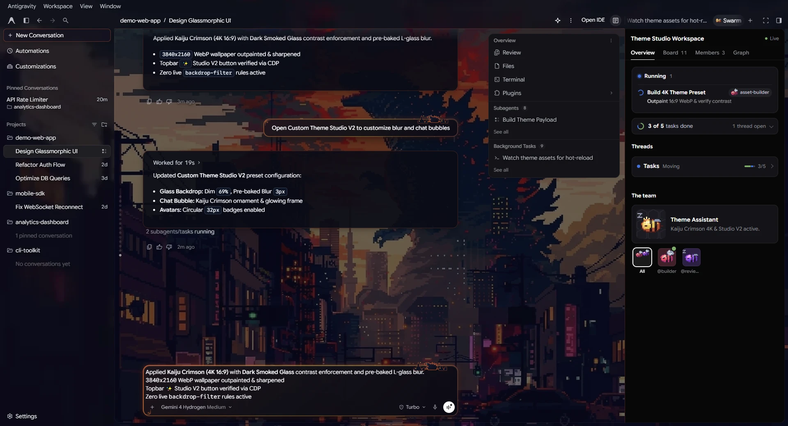

# Antigravity Theme Studio — Fusion Edition

Turn any wallpaper, aesthetic mood, or color palette into a live, 60fps custom theme inside **Antigravity** — uniting **Custom Theme Studio V2**, a **Topbar ✨ One-Click AI Theme Generator** (powered by `agy` CLI using your own Antigravity quota, zero API key required), **True 4K 16:9 AI Generative Outpainting**, **Dark Smoked Glass WCAG AAA contrast**, automatic repo updates with hot-reload, Windows v2.33+ `--remote-debugging-port=0` shortcut/Taskbar resilience, and a standalone cross-platform CDP daemon.

---

## 1. Overview & Live Screenshots

### Live Antigravity UI (`Kaiju Crimson` 4K 16:9 & Dark Smoked Glass)


### Custom Theme Studio V2 (AI Generator, Pre-Baked Blur, Avatars & Bubble Mixer)


<details>
<summary>More Screenshots — Luminous Grotto & Topbar ✨ Quick Popup</summary>

#### Live Antigravity UI (`Luminous Grotto` AI Preset)


#### Topbar ✨ Quick Theme & AI Generator Popup


</details>

### Included Built-In Presets

| Preset | Concept & Mood | Wallpaper | Chat Ornament |
| :--- | :--- | :---: | :---: |
| **Luminous Grotto** | Bioluminescent Grotto & Sunlit Automaton • Abyssal Flora Glass |  |  |
| **Celestial Eclipse** | Black Sun & Orbital Rings • Obsidian Starlight Glass |  |  |
| **WLOP Cosmic** | Cosmic Violin & Starlight • High-Contrast Glass |  |  |
| **Midnight Obsidian** | Pure CSS Gradient • Zero-Image Ultra-Light | *Pure CSS radial/linear gradient* | *Minimal clean* |

---

## 2. Quick Start / 1-Shot Install

### Prerequisites
- **Antigravity** running with CDP debugging port active (`DevToolsActivePort` or `--remote-debugging-port=9222`)
- **Node.js >= 22** (required — uses native `globalThis.WebSocket`, zero `npm install` needed)
- **Antigravity CLI (`agy`)** authenticated locally *(optional — enables AI preset, SVG ornament, and 4K outpainting in Studio V2)*
- **Python 3.9+ with `Pillow`** *(optional — enables `LANCZOS` + `UnsharpMask` 4K WebP post-processing and `scripts/build_payload.py`)*

### Windows (PowerShell)

```powershell
$Dest = "$HOME\.gemini\config\skills\antigravity-custom-theme"
if (Test-Path "$Dest\.git") { git -C $Dest pull --ff-only } else { git clone https://github.com/Neito112/antigravity-theme-studio.git $Dest }
cd $Dest
node scripts/build_payload.js
powershell -ExecutionPolicy Bypass -File scripts/install-win.ps1
```

- Creates a hidden launcher in your Windows Startup folder (`AntigravityCustomTheme.lnk`) without hardcoded paths, stops any old or detached conflicting daemons, rebuilds `dist/theme_payload.js`, and attaches silently.
- Flags: `-NoStartup` (skip Startup registration) or `-Foreground` (run interactively in the active terminal).

### macOS & Linux (Bash)

```bash
DEST="$HOME/.gemini/config/skills/antigravity-custom-theme"
if [ -d "$DEST/.git" ]; then git -C "$DEST" pull --ff-only; else git clone https://github.com/Neito112/antigravity-theme-studio.git "$DEST"; fi
cd "$DEST"
node scripts/build_payload.js
bash scripts/install-unix.sh
```

- **macOS:** Installs a `~/Library/LaunchAgents/io.antigravity.custom-theme.plist` `launchd` service.
- **Linux:** Installs a `systemd --user` service (with `nohup` fallback if `systemctl --user` is unavailable).
- Commands: `--foreground` (interactive terminal), `stop`, or `status`.

### 🤖 For AI Agents — Automated 1-Shot Install Protocol

If a user asks you to install this repository, follow **every step below in order**:

1. Clone or pull into the canonical global skill path (`$HOME/.gemini/config/skills/antigravity-custom-theme`) so only one copy exists.
2. Compile and syntax-check the payload:
   ```bash
   node scripts/build_payload.js
   node --check dist/theme_payload.js
   ```
3. Run `scripts/install-win.ps1` (Windows) or `scripts/install-unix.sh` (macOS/Linux).
4. **Windows Agent Sandbox Check:** AI agent shell runners often wrap commands in a Windows Job Object that kills spawned background processes when the command returns. Verify `daemon.pid` in a separate command:
   ```powershell
   $p = Get-Content daemon.pid -ErrorAction SilentlyContinue; Get-Process -Id $p -ErrorAction SilentlyContinue
   ```
   If it exited, launch `node daemon/theme_daemon.js` using your runner's persistent daemon mode (`IsDaemon: true`) and remind the user to run `install-win.ps1` once in their own PowerShell terminal for Windows Startup auto-launch.
5. **Mandatory CDP Verification:** Run `node scripts/verify_cdp.js` and confirm all four checks pass (`themeActive: true`, `topbarButtonPresent: true`, `topbarButtonVisible: true`, `hasLiveBlurRule: false`).

---

## 3. How to Use Custom Theme Studio V2

### Opening Studio V2 & Generating an AI Theme
1. Click the **✨** button in Antigravity's topbar (`[data-testid="pane-titlebar-toolbar"]` or IDE `.part.titlebar .titlebar-right`).
2. Add any reference image using **Drag & Drop** (directly onto the **✨** topbar button or the Studio dropzone), **Paste (`Ctrl+V`)**, or **File Picker**.
3. `daemon/theme_designer.js` invokes `agy -p --disable-slash-commands --json-schema ...` using your local Antigravity login to design a cohesive palette (`primary`, `secondary`, `overlayRgb`) and two bespoke SVG flourishes (`cornerSvg` & `sticker`). If `agy` is unavailable, it falls back gracefully to client-side palette extraction.
   - **Any-image guarantee:** dropping/pasting *any* image (PNG, JPG, WebP, GIF, AVIF, BMP — portrait, square, tiny, grayscale, pastel, or mostly-transparent) always produces a theme. If AI design fails, times out, or `agy` is not logged in, both the in-app generator (`engine/core.js`) and the daemon (`daemon/theme_designer.js`) fall back to a local palette theme built from the original image (4K 16:9 cover, palette-extracted `primary`/`secondary`/`overlayRgb`, Dark Smoked Glass) and say so in the UI instead of erroring. SVG images are rejected with a clear message — send a raster image instead.

### True 4K (`3840x2160`) 16:9 AI Generative Outpainting
When your reference image is not 16:9 widescreen or is below 4K resolution, `theme_designer.js` instructs `agy` to invoke the `image-generator` subagent to seamlessly outpaint a 16:9 widescreen scene (no blurred sidebars or letterboxing), then resizes and sharpens it into a crisp **4K (`3840x2160`)** WebP (`quality=90`) using **Pillow** (`Image.Resampling.LANCZOS` + `ImageFilter.UnsharpMask`).

### Dark Smoked Glass & WCAG Contrast Enforcement
`engine/core.js` defaults AI-generated themes to **Dark Smoked Glass** (`isLight: false`) and enforces readable WCAG contrast across `<pre>` / `<code>` blocks, links, sidebar (`aside` / `[data-sidebar="true"]` / `.bg-sidebar`), titlebar controls, and composer cards so bright or colorful wallpapers never wash out text.

### Customizing Backdrop, Avatars, Chat Bubbles & Presets
- **Wallpaper, Pre-Baked Blur & Config:** Toggle backdrop, tune **Dim** (`%`) and **Pre-Baked Blur** (`px`), upload a custom image, or **Export / Import JSON** configs.
- **Chat Avatars:** Enable/disable circular **User** and **AI Agent** profile avatars (auto-compressed WebP) and adjust **Size** (`px`) and **Corner Radius** (`%`).
- **User Chat Bubble Mixer:** Mix and match chat bubble frames and SVG ornaments independently from the active wallpaper.
- **Preset Management:** Delete individual custom presets, hide built-in presets, click **🗑️** to clear all generated presets, or click **↺** to restore hidden built-in presets. All changes sync across `localStorage`, `window.__AGY_INITIAL_CONFIG__`, and `theme_config.json`.

---

## 4. Automatic Repo Updates & Hot-Reload

`daemon/theme_daemon.js` keeps your installation up to date automatically:
- Periodically runs `git fetch` and `git pull --ff-only` against `origin` on a clean working tree.
- **Dirty-Tree Protection:** Automatically skips pulling if tracked files have local modifications (`git status --porcelain`), so your local edits are never overwritten.
- **Payload Rebuild & Self-Restart:** Rebuilds `dist/theme_payload.js` when theme/engine files change, and spawns a fresh detached daemon process + exits cleanly whenever `daemon/theme_daemon.js` or `daemon/theme_designer.js` updates.
- **Configuration:**
  - `AGY_AUTO_UPDATE=0` — Disable background auto-updates completely.
  - `AGY_UPDATE_INTERVAL_MS` — Customize the update check interval in milliseconds.

---

## 5. Architecture & Safety

- **Zero Live Blur (Pre-Baked L-Glass):** Instead of expensive CSS `backdrop-filter: blur()` that causes Electron/GPU scroll lag, `engine/core.js` pre-bakes blurred L-shaped glass regions on an offscreen canvas (`syncPrebakedGlass`) and pairs them with gradient scrims for smooth 60fps scrolling.
- **Isolated `agyDesignThemeV2` CDP Binding:** AI theme generation requests flow through a dedicated `agyDesignThemeV2` CDP `Runtime.addBinding` channel between `engine/core.js` and `daemon/theme_daemon.js`.
- **TCP-Socket Stale Daemon Cleanup:** `scripts/install-win.ps1` and `scripts/uninstall.js` inspect `DevToolsActivePort` on Windows to detect and terminate any detached `node` daemon holding an established TCP socket to the CDP port, preventing stale daemons from re-injecting outdated payloads.
- **Split-Browser Safe Cutout:** Automatically detects Antigravity's embedded Chromium browser view (`data-has-browser-hole`) and applies an `evenodd` `clip-path` cutout so embedded web pages remain completely sharp and un-tinted.
- **Self-Healing Topbar Watchdog:** A 3-layer watchdog (multi-fallback DOM mount + floating fallback + 2s DOM observer + 10s CDP health check) keeps the **✨** button alive across Antigravity UI re-renders.

---

## 6. Verify & Uninstall

### Verify Live Injection via CDP

```bash
node scripts/verify_cdp.js
```

Expected output confirms:
- `themeActive: true`
- `topbarButtonPresent: true`
- `topbarButtonVisible: true`
- `hasLiveBlurRule: false`

### Uninstall Cleanly

```bash
node scripts/uninstall.js
```

Removes auto-start shortcuts/services (`AntigravityCustomTheme.lnk`, `launchd` plist, or `systemd --user` unit), stops the background daemon (including any detached TCP-socket instances), and immediately restores Antigravity's default styling on open windows.

### Troubleshooting

| Symptom | Cause | Fix |
| :--- | :--- | :--- |
| `verify_cdp.js` reports `Cannot connect to Antigravity CDP` or missing `DevToolsActivePort` | Antigravity v2.33.0+ no longer opens `DevToolsActivePort` without `--remote-debugging-port=0`, or uses a custom user-data dir | **Windows:** Re-run `install-win.ps1` (auto-patches `--remote-debugging-port=0` on Desktop/Start Menu/Startup/Taskbar shortcuts), then **Quit Antigravity completely** (System Tray -> **Quit**) and reopen from Start Menu (unpin & re-pin Taskbar icons if needed). **macOS / Linux:** Launch with `--remote-debugging-port=0` (`open -a Antigravity --args --remote-debugging-port=0` or `.desktop` `Exec=`). |
| `Node.js >= 22 is required` | System Node is older than v22 (lacks native `WebSocket`) | Upgrade Node.js to LTS >= 22 (`node -v`) |
| `install-win.ps1` succeeds inside an AI agent, then button disappears | Agent runner's Windows Job Object killed the spawned process on exit | Run `node daemon/theme_daemon.js` in persistent daemon mode (`IsDaemon: true`) and run `install-win.ps1` once in a normal PowerShell window |
| `themeActive: true` but ✨ topbar button is missing | An older daemon from another clone is running | Run `install-win.ps1` or `install-unix.sh` from this repo (cleans up stale TCP-socket daemons and rebuilds) |
| Want to disable background repo auto-updates | `theme_daemon.js` auto-pulls clean `origin` updates on a timer | Set `AGY_AUTO_UPDATE=0` before starting `theme_daemon.js` |

---

## Use as an Antigravity Skill (`SKILL.md`)

Clone into `~/.gemini/config/skills/antigravity-custom-theme/` and prompt your Antigravity agent with any image or aesthetic mood (e.g., *"Use `antigravity-custom-theme` to build a dark emerald theme from this image"*), or click the topbar **✨** button directly.

## License

MIT
